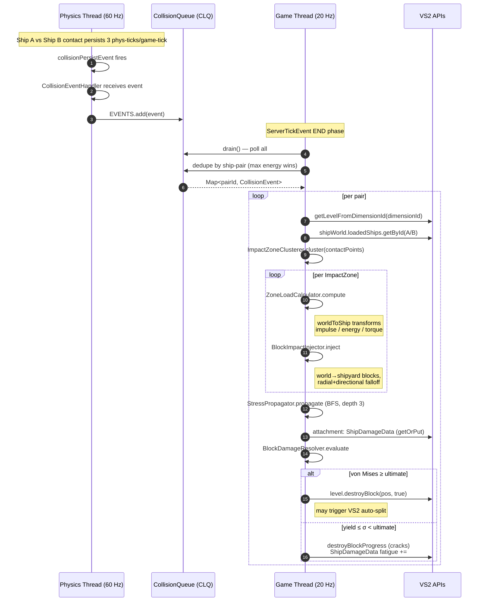

# Collision data flow

Related: [Documentation index](../index.md) · [Threading and event handoffs](../guides/threading-and-event-handoffs.md) · [Stress and material pipeline](stress-and-material-pipeline.md)

> [!warning]
> The current CollisionQueue retains CollisionEvent instances and consumes their
> contacts on the game thread. CollisionEvent and ContactPoint are physics-tick
> API types. This page documents the current flow; the required safe evolution
> is the application-owned snapshot handoff in the threading guide.

---

## 1. The Whole Picture



## 2. Stage-by-Stage Reference

| # | Stage | File | Thread | Input → Output |
|---|---|---|---|---|
| 1 | Capture | CollisionEventHandler | Phys | CollisionEvent received |
| 2 | Queue | CollisionQueue.enqueue | Phys | event enters ConcurrentLinkedQueue |
| 3 | Drain + dedupe | `CollisionQueue.drain/getAndClear` | Game | queue → `Map<pairId, event>` |
| 4 | Resolve | `DamageApplicator.processCollision` | Game | `dimensionId` → `ServerLevel`; `ShipId` → `LoadedServerShip`; world side = null ship |
| 5 | Cluster | `ImpactZoneClusterer.cluster` | Game | `ContactPoint`s → ≤6 `ImpactZone`s (radius 2.0, normal cos ≥0.8) |
| 6 | Load | `ZoneLoadCalculator.compute` | Game | zone + masses → `ImpactZoneResult` (impulse, energies, torqueFactor, direction) |
| 7 | Inject | `BlockImpactInjector.inject(…)` | Game | zone ⊗ shipyard blocks → `Map<BlockPos, InjectedStress>` |
| 8 | Merge zones | `DamageApplicator.mergeInto` | Game | per-zone stress maps → aggregated map |
| 9 | Propagate | `StressPropagator.propagate` | Game | injected → propagated `Map<BlockPos, BlockStressState>` |
| 10 | Evaluate | `BlockDamageResolver.evaluate` | Game | stress vs. material → fatigue (`ShipDamageData`), cracks, or `destroyBlock` |

## 3. Data Invariants Passing Between Stages

1. **Thread boundary between 2 and 3.** Only immutable, plain-data objects cross. All VS2/Android-game objects (`LoadedServerShip`, `ServerLevel`, `ShipTransform`) are resolved *fresh* on the game thread (stage 4) — never carried over.
2. **World-space in, ship-space out.** Stages 1–5 deal in world space. Stage
   6/7 is where worldToShip converts positions/directions; stage 7+ lives in
   shipyard/block space. See [coordinate spaces](coordinate-spaces.md).
3. **Each ship sees the collision from its own side.** `ImpactZone.inverted()` negates normal/velocity/direction so ship B's damage is computed with B-centric geometry (stage 5→6 in `DamageApplicator`).
4. **Energy conservation by construction.** Injected stress across all blocks sums exactly to `damageEnergy` (weights are normalized), split into compression/shear by the normal/shear energy shares. Propagation attenuates but never amplifies.
5. **Idempotence.** All game-thread maps are recreated per tick. The only mutation surviving across ticks is `ShipDamageData` (attachment) and actual block state.

## 4. The `DamageApplicator` Orchestrator (annotated)

The Java source is the canonical orchestrator; here is the Kotlin narration with the why's:

```kotlin
@OptIn(GameTickOnly::class)
private fun processCollision(collision: CollisionEvent, server: MinecraftServer) {
    // (4) Resolve world + ships
    val level = server.getLevelFromDimensionId(collision.dimensionId) ?: return
    val shipWorld = level.shipObjectWorld
    val shipA = shipWorld.loadedShips.getById(collision.shipIdA)
    val shipB = shipWorld.loadedShips.getById(collision.shipIdB)
    if (shipA == null && shipB == null) return   // stale event — both sides unloaded

    val massA = shipA?.inertiaData?.mass ?: 0.0
    val massB = shipB?.inertiaData?.mass ?: 0.0

    // (5) Cluster
    val impactZones = ImpactZoneClusterer.cluster(collision.contactPoints)

    val stressOnA = HashMap<BlockPos, InjectedStress>()
    val stressOnB = HashMap<BlockPos, InjectedStress>()
    val stressOnWorld = HashMap<BlockPos, InjectedStress>()

    for (zone in impactZones) {
        // (6)+(7) ship A side
        if (shipA != null) {
            val result = ZoneLoadCalculator.compute(zone, massA, massB, shipB == null, shipA)
            if (result != null && result.impulse >= MIN_DAMAGE_IMPULSE)
                mergeInto(stressOnA, BlockImpactInjector.inject(zone, result, shipA, level))
        }
        // world side of A↔world
        if (shipA != null && shipB == null) { /* ZoneLoadCalculator.compute(zone, …, true, shipA)
                                                  → BlockImpactInjector.injectWorld(...) */ }
        // (6)+(7) ship B side — geometry INVERTED so B is the victim frame
        if (shipB != null) {
            val inv = zone.inverted()
            val result = ZoneLoadCalculator.compute(inv, massA, massB, shipA == null, shipB)
            if (result != null && result.impulse >= MIN_DAMAGE_IMPULSE)
                mergeInto(stressOnB, BlockImpactInjector.inject(inv, result, shipB, level))
        }
        // world side of B↔world
        if (shipB != null && shipA == null) { /* …injectWorld… */ }
    }

    // (9)
    val propagatedA = StressPropagator.propagate(shipA, stressOnA, level)
    val propagatedB = StressPropagator.propagate(shipB, stressOnB, level)
    val propagatedWorld = StressPropagator.propagateWorld(stressOnWorld, level)

    // (10)
    val dataA = shipA?.getOrPutAttachment(Supplier { ShipDamageData() })
    val dataB = shipB?.getOrPutAttachment(Supplier { ShipDamageData() })
    val dataW = worldDamageData.computeIfAbsent(level.dimensionId) { ShipDamageData() }

    BlockDamageResolver.evaluate(propagatedA, shipA, level, dataA)
    BlockDamageResolver.evaluate(propagatedB, shipB, level, dataB)
    BlockDamageResolver.evaluateWorld(propagatedWorld, level, dataW)
}
```

## 5. Failure Modes & Skips (where data falls out of the pipe)

| Skip | Guard | Logged? |
|---|---|---|
| Dead collision (null) | `if (collision == null) return` | — |
| Unknown dimension | `level == null` | `LOGGER.warn` |
| Both ships unresolved | `shipA == null && shipB == null` | `warn` |
| Zero effective mass | `totalMass ≤ ε` / `effectiveMass ≤ 0` | `debug` |
| No contact velocity | fallback metrics fail | `debug` |
| Sub-threshold impulse | `impulse < MIN_DAMAGE_IMPULSE (50.0)` | `debug` |
| No solid block near impact seed | `findNearestSolidBlock` null | `warn` |
| No eligible voxels in radius | `totalWeight ≤ 1e-9` | silent |
| Nothing propagated | `stressField.isEmpty()` | `debug` |
| Air / indestructible at resolution | `state.isAir` / `yield == MAX_VALUE` | silent |
