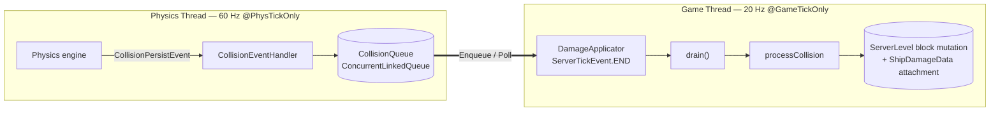

# VS Collisions — Developer Wiki

> [!info] Scope
> Technical documentation for the **Collision, Damage & Destruction System** of the `vs_collisions` mod (Forge 1.20.1), built against **Valkyrien Skies 2** and verified against the decompiled/sourced VS2 core (`vs-core 1.1.0+cf208d8b56`, `valkyrienskies-120-forge 2.4.11`).

## Environment

| Component | Version | Source |
|---|---|---|
| Minecraft | 1.20.1 | `gradle.properties` |
| Forge | 47.4.10 | `legacyForge` (ModDev plugin) |
| Valkyrien Skies 2 | 2.4.11 | `valkyrienskies-120-forge` |
| VS Core | 1.1.0+cf208d8b56 | `org.valkyrienskies.core:{api,internal,impl,util}` |
| Java / JVM target | 17 | `options.release = 17` |
| Kotlin | 2.0.0 (Kotlin for Forge 4.11.0) | present on classpath |
| Optional dependency | Create Big Cannons 5.11.0-dev (`rbasamoyai`) | armor hardness/toughness provider |

> [!note]- Why Kotlin snippets when `src/` is Java?
> The current implementation under `src/main/java` is **Java**. All code examples in this wiki are written in **Kotlin** (idiomatic call sites of the exact same compiled APIs, using Kotlin-for-Forge). Kotlin simply gives null-safety, named arguments and reified attachment accessors; every symbol used maps 1:1 onto the Java sources and the VS2 sources verified against the Gradle cache.

## The Threading Contract in One Picture



**Rule of thumb:** the physics thread may only *produce immutable snapshots*; the game thread may only *consume them*. See [[01-Threading-and-Event-Handoffs]].

## Wiki Pages

| Page | Contents |
|---|---|
| [[01-Threading-and-Event-Handoffs]] | `CollisionPersistEvent` capture at 60 Hz, `ConcurrentLinkedQueue` handoff, `ServerTickEvent` drain, race-condition catalogue |
| [[02-Ship-Attachments-and-Persistence]] | `AttachmentHolder` API, registration, serializers, `ShipDamageData` fatigue model |
| [[03-Coordinate-Space-Math]] | World-space ⇄ shipyard-space transforms, contact-point math, direction vs. position pitfalls |
| [[04-Ship-Lifecycle-and-Fracturing]] | `VsiServerShipWorld` — query, `createNewShipAtBlock`, `deleteShip`, VS2 auto-split |
| [[05-Block-Mutation-and-Destruction]] | Shipyard block mutation, `destroyBlock`, crack overlays, Von Mises failure model |
| [[06-End-to-End-Data-Flow]] | Full collision → destruction pipeline walkthrough |
| [[07-Stress-and-Material-Pipeline]] | Codebase internals: zone clustering, load calculation, injection, propagation, material thresholds |
| [[08-API-Reference]] | Verified VS2 / vs-core signatures used by this project |

## Source Map (what lives where)

```
src/main/java/dev/kkazi/vscollisions/
├── VSCollisions.java              # @Mod entrypoint, attachment registration
├── collision/
│   ├── CollisionEventHandler.java # Physics-thread subscriber → enqueue
│   └── CollisionQueue.java        # CLQ handoff + per-pair dedupe
├── impact/
│   ├── ImpactZoneClusterer.java   # ContactPoint → ImpactZone spatial clustering
│   ├── ImpactZone.java            # Zone accumulator (position/normal/severity sums)
│   ├── ImpactZoneResult.java      # Computed energies/impulse record
│   └── ZoneLoadCalculator.java    # Effective-mass, impulse, energy, torque factors
├── stress/
│   ├── BlockImpactInjector.java   # Zone → per-block InjectedStress (falloff + direction)
│   ├── StressAccumulator.java     # Inject → BlockStressState conversion
│   ├── StressPropagator.java      # BFS stress spreading (max depth 3)
│   ├── InjectedStress.java        # Mutable weighted stress vector
│   └── BlockStressState.java      # Immutable per-block stress + Von Mises scalar
├── material/
│   ├── CollisionMaterialRegistry.java # Yield/ultimate thresholds, overrides
│   └── CbcToughnessHelper.java        # Create Big Cannons integration w/ fallback
└── damage/
    ├── DamageApplicator.java      # Game-thread orchestrator (ServerTickEvent)
    ├── BlockDamageResolver.java   # Stress vs. material → fatigue / crack / destroy
    └── ShipDamageData.java        # Per-ship fatigue attachment
```

## Golden Rules (read first)

> [!warning] Physics epoch ≠ Game epoch
> 1. **Capture** on the physics thread is push-only: snapshot values, enqueue, return. Never resolve `ServerLevel`, ships, or blocks there.
> 2. **Process** on the game thread (`TickEvent.ServerTickEvent`, `Phase.END`): drain queue, resolve `ServerLevel`/`LoadedServerShip`, mutate blocks, read/write attachments.
> 3. `CollisionEvent` and `ContactPoint` are `@PhysTickOnly`; `LoadedServerShip`, `VsiServerShipWorld`, `ServerLevel` are `@GameTickOnly`. Crossing either boundary directly is a race condition.
> 4. Attachment *handles* are thread-safe per the VS2 docs ("Setting and retrieving attachments is thread-safe"), but the **contents** of your attachment object are not — mutate them on the game thread only.
> 5. Every block coordinate used for mutation must be a **shipyard coordinate**. Physics data arrives in **world space** — transform with `worldToShip` (`toModel`) first. See [[03-Coordinate-Space-Math]].
